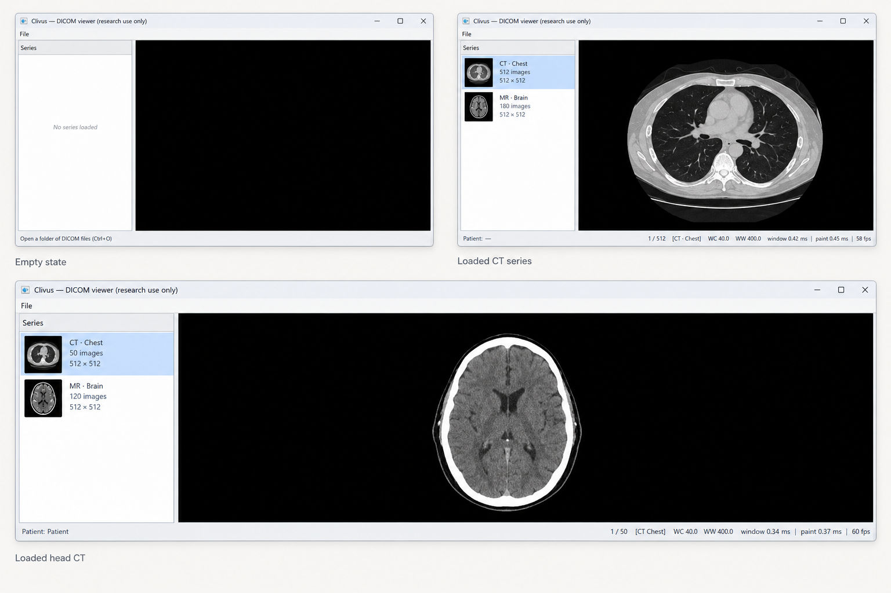
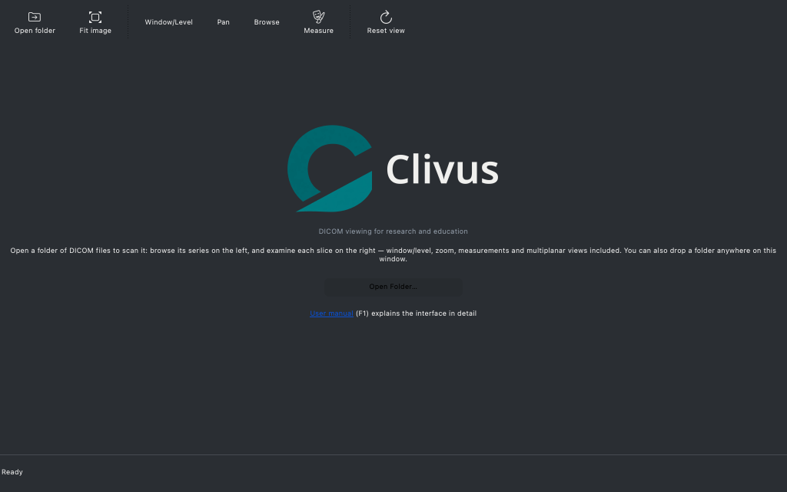
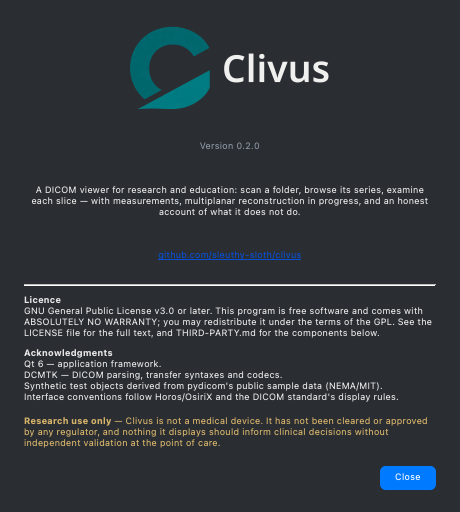
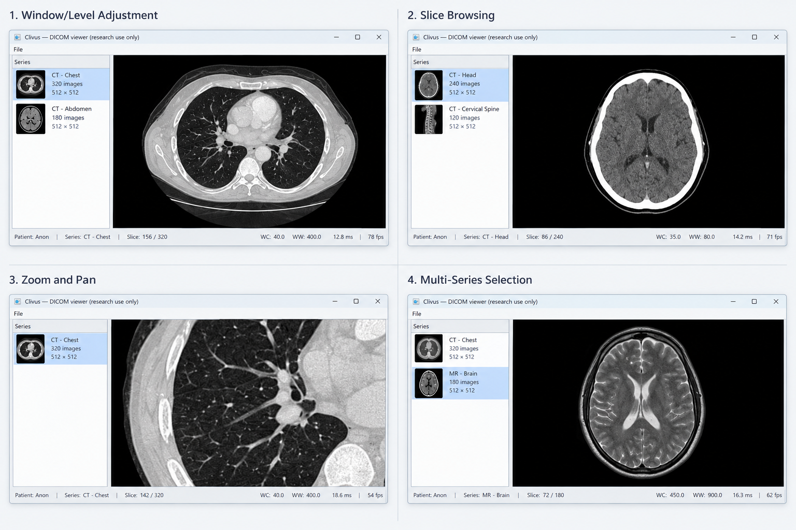
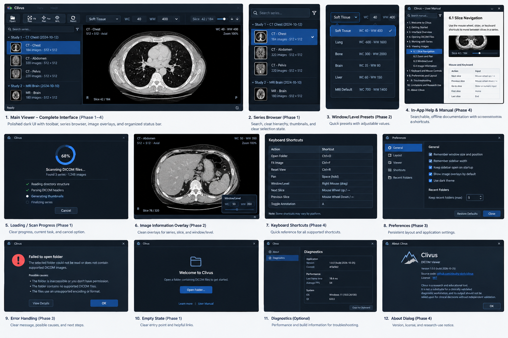
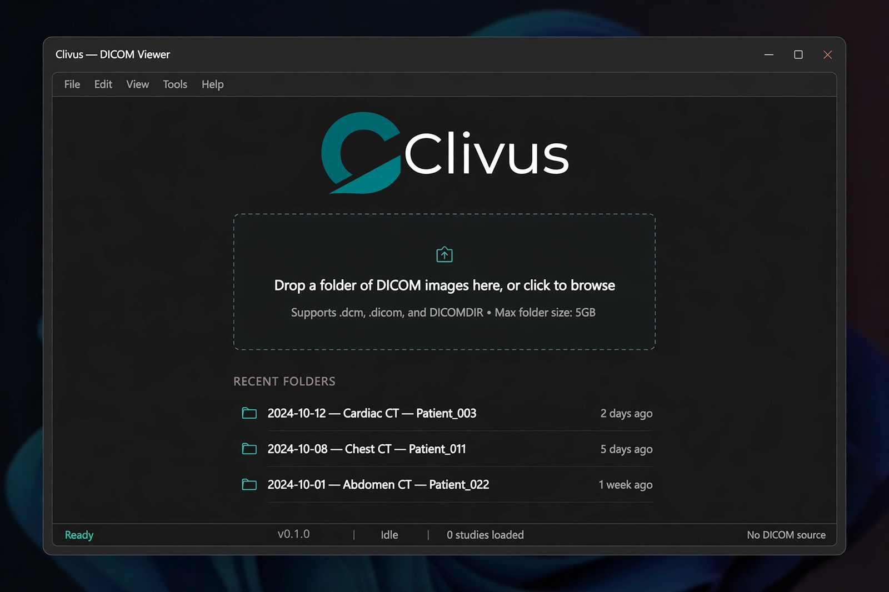
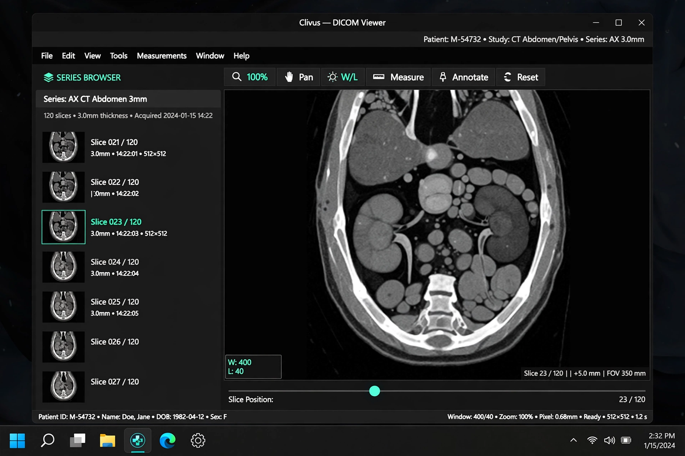
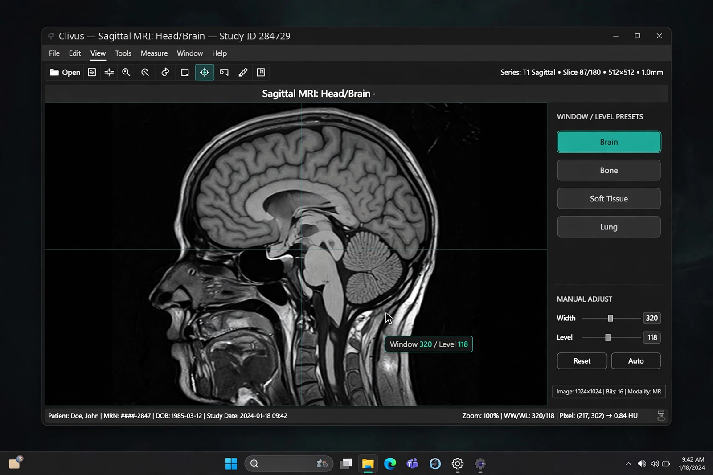
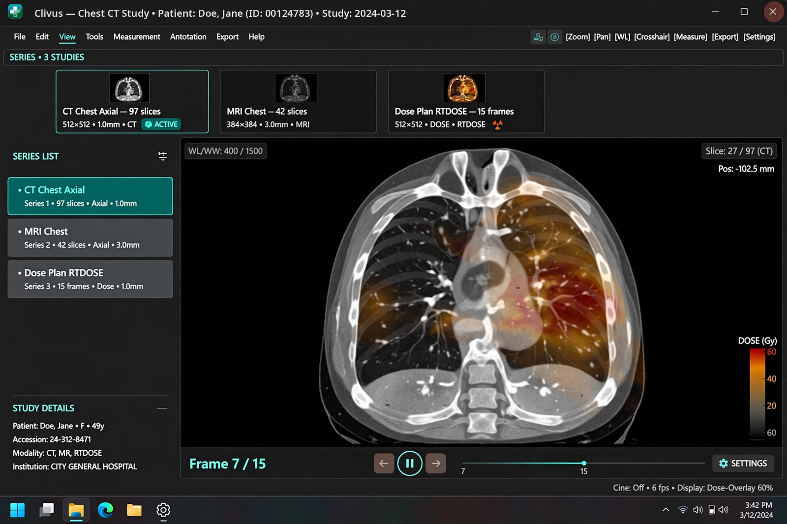
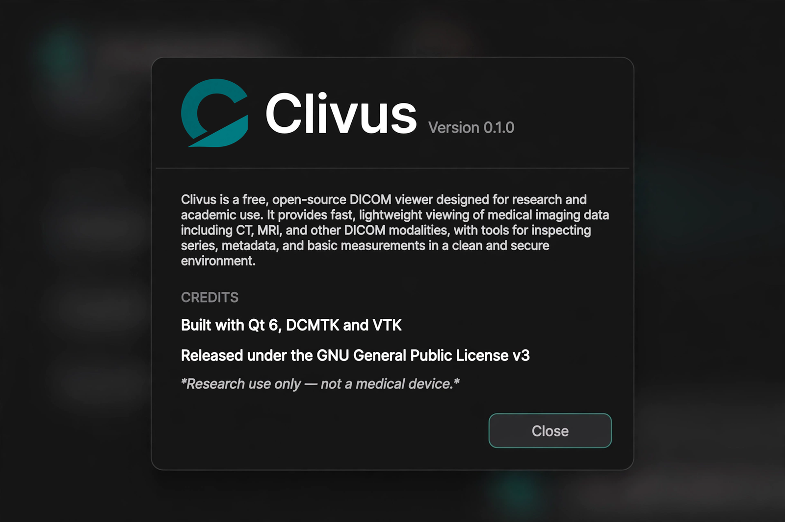

# Clivus

[](https://github.com/sleuthy-sloth/clivus/actions/workflows/windows.yml)


**If you study, teach, or do research on medical images and you don't own a Mac,
your viewer choices are bad, expensive, or both.** Horos and OsiriX — the two
genuinely good free DICOM viewers — are macOS only. On Windows, the platform most
of the medical and research world actually runs, your realistic options are a
locked-down PACS workstation you don't control, subscription seats priced for
hospitals, half-priced versions with the features greyed out, or extracting
pixels by hand. The good tool exists. It just isn't available to you.

Clivus is the answer: **a new, free, open-source DICOM viewer that follows the
Horos/OsiriX workflow and is built Windows first.** Drag-to-window on the canvas,
series thumbnails that load real series correctly, volume stacks that aren't
fooled by shuffled filenames. Same feel as the tools people love, none of the
assumption that you own a Mac.

> **Research tool, not a medical device.** No regulatory clearance, no clinical
> validation, nothing here for diagnosis or any decision affecting patient care.
> The clinical-grade path is the ambition; this is the foundation it gets built
> on, in the open, loudly.

It shares no code with Horos or OsiriX — new codebase, proven open ingredients
(Qt 6, DCMTK, OpenGL, SQLite). "Horos" and "OsiriX" are trademarks of their
respective owners.

## Why build this now

Three arguments, in order of how much they weighed.

**1. The gap is real and measurable.** macOS has had twenty years of serious free
DICOM tooling. Windows has been served trial ware, watermarked exports, and
enterprise pricing. A resident with a ThinkPad and a research question — or a
hospitalist reviewing a CT from a training set — has nowhere to go. That's a
market hole, not a niche.

**2. Trust has to be engineered, not promised.** The failure mode that matters in
a viewer is a pixel that is slightly wrong — compression quietly changing a
value, an upgrade changing output. There is exactly one cure: tests that compare
decoded images to ground truth and fail loudly. Clivus is built test-first for
exactly this reason; the fidelity table below is not decoration, it is the
product.

**3. The hard question has been answered.** Viewers historically stumble on
interaction speed: can the canvas keep up when a user drags the window across a
12-bit CT series? A spike in this repository answers *yes, with two orders of
magnitude of headroom* (0.34 ms to re-window a 512² frame against a 16.7 ms
budget). That converts "build a Windows DICOM viewer" from open research into an
engineering plan — which is why this repo exists and why the remaining work is a
roadmap instead of a guess.

## What Clivus does today



Real, working, test-backed:

- **Browse a folder like a study** — series list with thumbnails and metadata lines
- **Window/level with the Horos gesture.** Left-drag widens/centres; the maths is
  the DICOM linear VOI LUT, not an approximation of it.
- **Decode nearly everything's pixels — including colour.** Explicit-VR LE, RLE,
  JPEG, JPEG-LS, and JPEG 2000 where the DCMTK build carries it, plus RGB and
  YBR_FULL colour photometrics (planar variants converted by DCMTK, shown without
  windowing, as the DICOM standard prescribes) — with every lossless codec
  asserted pixel-identical to ground truth.
- **Browse whole multi-frame objects.** Multi-frame CT/MR and 15-frame RT Dose
  objects page through slice by slice, not frozen on frame 0.
- **Real dose units for RT objects.** DoseGridScaling is applied where
  RescaleSlope is absent, so an RT Dose reads in Gy instead of raw stored values.
- **Load volumes in physically correct order.** Sorted by position along the
  scan normal, spacing from real geometry, unit-tested against shuffled
  filenames and `InstanceNumber`.
- **Measure.** Distance in millimetres from each object's Pixel Spacing and
  angles through a three-click gesture. When an object carries no spacing the
  label says so — the app never invents a millimetre value.
- **Reslice in three planes.** Axial, coronal and sagittal side by side, synced
  through the scanner's own geometry with hairline crosshairs, shared
  window/level, and an honest disable for studies without per-slice geometry.
  First round: nearest-neighbour, labelled experimental.
- **Drag a folder straight in.** Drop a folder (or one DICOM file) anywhere on
  the window and it opens like File &#9656; Open.

The pipeline in one sentence: point it at a folder, click a series, drag the
window, watch 60 fps.

The way in, with the real logo and no study loaded — this is a screenshot of the
actual build, not a mockup:



The About panel holds the rest of the identity — version, repository, licence,
acknowledgments and the research-use disclaimer:



The daily interactions — window/level drag, slice browsing, zoom and pan, and
switching modalities with different window defaults:



Where the interface is going next — the working design sheets for the series
browser groups, the window/level panel, diagnostics, preferences and the manual:



## Fidelity: every supported syntax must prove itself

`clivus_test_decode testdata/corpus` is the codec matrix, and it is the most
important table in this repository:

| Transfer syntax | Test objects | brew DCMTK 3.7.1 | Windows CI (vcpkg + openjpeg) |
|---|---|---|---|
| Explicit VR LE | CT_small, MR_small | ok | ok |
| RLE Lossless | MR_small_RLE (16-bit), rtdose_rle (32-bit, 15 frames) | ok, pixel-identical to MR_small | ok |
| JPEG-LS Lossless / Near-lossless | MR_small_jpeg_ls_lossless, JPEGLSNearLossless_08/16 | ok, lossless variant pixel-identical | ok |
| JPEG 2000 Lossless / Lossy | MR_small_jp2klossless, JPEG2000, MR2_J2KI | not in this build | asserted identical to MR_small |

The three lossless variants of `MR_small` must decode to **exactly** the
uncompressed pixel values. If a DCMTK upgrade ever silently changes decompressed
output, the suite fails before a human image is wrong. Lossy and near-lossless
objects are smoke-tested for dimensions only, and their rows say so.

## Using it

**No toolchain required:** grab **[v0.1.0](https://github.com/sleuthy-sloth/clivus/releases)** —
the release page carries a runnable `clivus` zip (exe + Qt/DCMTK DLLs + test
corpus + licence pack), permanently; the CI artifact above is the same thing,
rebuild daily at the current HEAD. Download, unzip, and on any Windows machine:

```powershell
clivus.exe .\corpus --bench 150
```

Read the GL line it prints at startup: a real vendor (NVIDIA/AMD/Intel) makes the
fps number meaningful; `GDI Generic` means no real driver and the numbers are
worthless. Details in [`docs/windows.md`](docs/windows.md), the full runbook.

**From source:**

```bash
# macOS (Homebrew Qt6 + DCMTK)
brew install qt dcmtk
cmake --preset mac && cmake --build --preset mac
build/mac/app/clivus testdata/synthetic512 --bench 150
```

```powershell
# Windows (MSVC + vcpkg; set VCPKG_ROOT first)
cmake --preset win
cmake --build --preset win
ctest --preset win
```

`testdata/make_synthetic.py` generates a synthetic 8-slice CT series with
slope/intercept and `PixelPaddingValue`, so development never needs patient data;
`testdata/corpus/` carries ten small public sample objects.

---

# Technical notes

Everything below is for people extending or auditing the code — nothing here is
needed to run the viewer.

## The spike that started it

Clivus began as one yes/no question: **does a Qt6 + OpenGL canvas hold 60 fps on
real series while windowing?** The repository is still shaped like the
laboratory that answered it — measurement harnesses in `core/tools`, adversarial
test data in `testdata`, and a `core/` that builds and tests without any GUI
toolkit at all.

- `core/` — Qt-free, unit-tested: series scan (DCMTK), modality-value frames,
  linear VOI LUT window/level, volume geometry.
- `app/` — Qt6 Widgets shell around the GL canvas, with the bench mode that
  produced every number in this document.

## Measured performance (Apple M-series, Qt 6.12 + DCMTK 3.7.1, release)

`clivus <folder> --bench N` repaints the canvas N times with the window/level
nudged each frame — it pays the full drag cost (re-window + texture upload +
draw):

| Image | window (CPU, ms) | paint (CPU, ms) | fps | decode (ms/slice) |
|---|---|---|---|---|
| 512×512 | 0.34 | 0.37 | 60 (vsync-capped) | 0.7 |
| 1024×1024 | 1.16 | 1.18 | 60 (vsync-capped) | 2.8 |

Windowing alone, no GL (`clivus_measure`): 0.20 ms at 512², 0.80 ms at 1024².
Two orders of magnitude under budget.

## Loader internals the codec matrix forced

1. **DCMTK registers no decoder by default.** RLE, JPEG, JPEG-LS and JPEG 2000
   each need their own `…Registration::registerCodecs()` call, or compressed
   files fail with `can't change to unencapsulated representation for pixel
   data`. `core/src/codecs.cpp` registers all of them once, `__has_include`-guarded
   so a codec-less DCMTK build still compiles.
2. **JPEG 2000 is a property of the DCMTK build, not of DCMTK.** Homebrew's
   ships no J2K decoder; vcpkg's does via the `openjpeg` feature, which is why
   `vcpkg.json` asks for it and why Windows CI asserts the J2K rows decode
   identically rather than merely attempting them.
3. **Encapsulated pixel data goes through the codec path**
   (`chooseRepresentation(EXS_LittleEndianExplicit)`) instead of `DicomImage`'s
   own route, which rejects valid objects such as 32-bit RLE RT Dose — one code
   path for every file.
4. **32-bit multi-frame objects** hand back the whole frame stack in one buffer;
   the loader treats it as a slice stack, so every frame is browsable — frame 0
   is no longer the only one that exists. Non-linear Modality LUT Sequences and
   PALETTE COLOR tables are applied at decode time — what you see is the tables'
   own output, and the window numbers describe it
   (see `core/include/clivus/image_frame.h`).

## Volume loading

Geometry first, filenames never: `loadVolume()` orders slices **by position
along the slice normal**, not by `InstanceNumber` and not by filename. Spacing
comes from `PixelSpacing` plus the median gap between slice positions. The unit
test is adversarial: a committed 4-slice series whose pixel values name their own
index and whose filenames run backwards — trusting files *or* tags fails it.

TCIA `4D-Lung`, 50 × 512²: whole stack in **58–100 ms**. VTK rendering is
opt-in (`cmake --preset mac-vtk`, `CLIVUS_BUILD_VTK_PROBE=ON`) through
`app/vtk_probe.cpp`, deliberately Qt-free; 8 ms/frame GPU after a 163 ms first
frame.

## The series index

Opening a folder writes `<folder>/.clivus-index.sqlite`, keyed on a fingerprint
of the folder (file count, newest mtime, total bytes). Unchanged folder, cached
in ~1 ms; changed folder, automatic miss and rescan — no invalidation logic
because there is nothing to invalidate.

| 50-slice real CT series | scan |
|---|---|
| first start, no index | 29.7 ms |
| every start after | 1.2–1.7 ms |

## How the tests work

They are `assert`-based, and `Release` builds define `NDEBUG`, which erases every
check while the binary still prints "all checks passed". `core/CMakeLists.txt`
strips `NDEBUG` for test targets — without that, the CI suite proved nothing.

## Design direction: the concept boards, and what they ask for

These five boards are **design targets, not screenshots of the current build.** They were drawn
ahead of the shipped interface, so several elements in them do not exist in the code yet — treat
them as the direction of travel, with the differences named below each one.


*Concept welcome. Shipped today: the lockup, the one-line description and Open Folder. Not built:
recent folders, a drag-and-drop zone with a size cap, an `Edit` menu.*


*Concept viewer. Shipped today: series browser, window/level, slice strip, status bar. Not built:
a patient banner, a per-slice thumbnail list, a `Measurements` menu, `Annotate`, a zoom-percentage
control.*


*Concept window/level. Shipped today: presets, editable centre/width, the Horos drag gesture.*


*Concept multi-frame browsing. Shipped today: multi-frame objects page slice by slice, RT Dose
decodes in Gy; MPR opens as a separate three-plane window rather than in this layout.*


*Concept About. Shipped today: the lockup, version, repository link, licence, acknowledgments and
the research-use disclaimer — see the real capture above.*

## Roadmap

- **In progress:** off-thread scan/thumbnail/slice decode with progress and
  cancel; `glTexSubImage2D` on the drag path; a full-header fallback in the scan
  (merged; pending a real-GPU bench).
- **Shipped since the spike:** multi-frame browsing; colour photometrics
  (RGB/YBR_FULL, planar converted); MODALITY LUT handling — including the
  non-linear LUT-Sequence shape and PALETTE COLOR tables, both applied at decode
  time with post-LUT window numbers; RT Dose dose units.
- **Then:** window/level parity tests against a real Horos; a vendored DCMTK
  with JPEG 2000 on macOS (bots can't decode what their build lacks — today
  only Windows CI exercises J2K).
- **v1:** VTK / MPR / 3D with `QVTKOpenGLNativeWidget` in the real viewer.
- **Not planned for v1:** PACS networking, measurement tools, plugin ABI.
- **Always out:** no AGPL code of any kind in this tree; the AGPL content that
  ships inside Horos 4.0.1 stays outside.

## Privacy

Clivus is offline by construction: no network calls, no accounts, no telemetry. The only thing it
writes besides your settings is a small series index so a folder opens quickly the second time — in
the OS application cache directory, never in your DICOM folder, and without patient names or
identifiers. Where it lives, what it stores, and how to clear it: [docs/PRIVACY.md](docs/PRIVACY.md).

## Licence

GPL-3.0-or-later — see [`LICENSE`](LICENSE). Qt 6 is used under its GPL-3.0
option, so binaries built from this repository are GPL-3.0-or-later as a whole.
DCMTK, SQLite, VTK and the JPEG-family codecs keep their permissive licences;
terms and required notices in [`THIRD-PARTY.md`](THIRD-PARTY.md).

Every claim in this README is backed by code in the tree. If one stops being
backed, the README should be the first thing to break.
